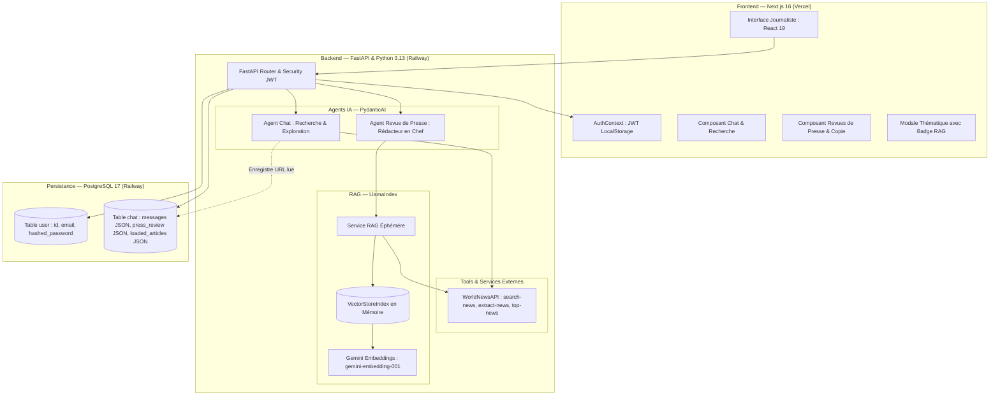

# 🏛️ Architecture Technique — NewsFoundry

NewsFoundry est une plateforme SaaS conçue pour les journalistes, pigistes et professionnels de l'information. Elle combine un assistant conversationnel d'investigation en temps réel et un générateur automatique de revues de presse journalistiques enrichies par RAG (*Retrieval Augmented Generation*).

---

## 📐 1. Vue d'Ensemble & Diagramme d'Architecture



---

## 📂 2. Arborescence du Projet

```text
Projet14/
├── README.md                      # Documentation principale du projet & Quickstart
├── .github/workflows/ci.yml       # Pipeline CI GitHub Actions (62 tests pytest automatisés)
├── docs/                          # Dossier de documentation technique (Étapes 9 & 10)
│   ├── ARCHITECTURE.md            # Détail de l'architecture et des flux
│   ├── CHOIX_TECHNIQUES.md        # Justifications de chaque choix technologique
│   ├── GUIDE_DEMARRAGE_TESTS.md   # Installation, démarrage et exécution des tests
│   └── AMELIORATIONS_PERFORMANCE.md # Analyse critique UX, MLOps MLflow, Streaming & Skills
│
├── backend/                       # API Backend FastAPI & Agents IA
│   ├── Dockerfile                 # Image de conteneurisation pour déploiement Railway
│   ├── pyproject.toml             # Configuration UV, dépendances et metadata Python
│   ├── uv.lock                    # Fichier de verrouillage déterministe des dépendances
│   ├── src/                       # Code source de l'application backend
│   │   ├── main.py                # Application FastAPI, routes REST et injection de dépendances
│   │   ├── agent.py               # Définition des agents PydanticAI et outils (Tools)
│   │   ├── auth.py                # Sécurité, hachage bcrypt et gestion des tokens JWT
│   │   ├── database.py            # Initialisation du pool SQLModel et migrations PostgreSQL
│   │   ├── models.py              # Modèles SQLModel (BDD) et schémas Pydantic (validation)
│   │   └── services/              # Modules de services externes et RAG
│   │       ├── world_news.py      # Client asynchrone WorldNewsAPI (recherche, extraction, top-news multi-pays, déduplication, cache 1h)
│   │       └── rag.py             # Service d'indexation vectorielle en mémoire LlamaIndex
│   └── tests/                     # Suite de tests automatisés (62 tests pytest)
│       ├── conftest.py            # Fixtures de test (base SQLite en mémoire, client de test)
│       ├── test_auth.py           # Tests JWT, rotation de mot de passe, anti-bruteforce & plafond FinOps (11 tests)
│       ├── test_chats.py          # Tests des discussions, isolation, /top-news et erreurs LLM (14 tests)
│       ├── test_sources.py        # Tests de garantie déterministe et déduplication des sources (6 tests)
│       ├── test_world_news.py     # Tests WorldNewsAPI, filtrage anti-bruit, déduplication et cache multi-pays (18 tests)
│       ├── test_press_review.py   # Tests de la génération et suppression de revue de presse (7 tests)
│       └── test_rag.py            # Tests du pipeline RAG LlamaIndex et intégration (6 tests)
│
└── frontend/                      # Application Frontend Next.js (App Router)
    ├── package.json               # Scripts NPM et dépendances frontend
    ├── tsconfig.json              # Configuration TypeScript stricte
    ├── next.config.ts             # Configuration Next.js (Turbopack)
    └── src/
        ├── context/
        │   └── AuthContext.tsx    # Contexte d'authentification React (JWT, persistance)
        └── app/
            ├── layout.tsx         # Layout racine (polices, métadonnées, AuthProvider)
            ├── page.tsx           # Page principale (Chat, Breaking News multi-pays, Revues de presse)
            ├── page.module.css    # Feuilles de styles CSS Modules fidèles aux maquettes
            └── login/             # Écran d'authentification utilisateur
                ├── page.tsx
                └── login.module.css
```

---

## 🔄 3. Flux de Données Détaillés

### A. Flux d'Exploration Journalistique & Breaking News Multi-Pays
1. **Breaking News régionales à l'accueil (`GET /top-news?country=...`) :**
   - À l'ouverture de l'application (ou lors d'un clic sur le sélecteur de pays : 🇫🇷 FR par défaut, 🇺🇸 US, 🇬🇧 UK, 🇩🇪 DE), le frontend interroge l'endpoint sécurisé `/top-news`.
   - Le service `get_top_news_api` applique un filtrage qualitatif par expressions régulières (`is_relevant_headline`) qui écarte le bruit non-informatif (podcasts, grilles horaires, bulletins météo, tirages de loterie et jeux quotidiens tels que *Wordle* ou *NYT Connections*) pour ne retenir que les 3 événements majeurs les plus relayés.
   - Les résultats sont mis en cache en mémoire vive pendant 1 heure de manière isolée par couple `{country}_{language}` afin de préserver le quota de 50 requêtes/jour de WorldNewsAPI.
2. **Requête utilisateur :** Le journaliste pose une question libre ou clique sur une manchette dans l'interface Next.js.
3. **Transmission sécurisée :** Le message est envoyé via `POST /chats/{chat_id}/messages` avec le Bearer Token JWT.
4. **Vérification d'accès :** L'API s'assure que `chat.user_id == current_user.id` (sinon rejet `403 Forbidden`).
5. **Exécution de l'Agent PydanticAI, Ciblage Géographique & Résilience des Outils :**
   - Si la question nécessite des faits récents, l'agent déclenche `search_news(query, language, country)`. Pour une actualité internationale (ex: US, UK, DE), l'agent (épaulé par un mécanisme de détection automatique en Python) cible directement les médias locaux dans leur langue d'origine tout en rédigeant sa synthèse en français.
   - Un filtre de résilience (`_simplify_query`) nettoie automatiquement les stopwords pour garantir des requêtes courtes (1 à 3 mots-clés) adaptées au moteur strict de WorldNewsAPI, et `deduplicate_news_articles` élimine les doublons de dépêches d'agences (URL canonique et similarité lexicale de Jaccard >= 70 %).
   - Si une lecture approfondie est requise, l'agent déclenche `get_article_content(url)`.
   - Grâce à l'injection `RunContext[ChatDeps]`, toute URL découverte par `search_news` ou lue par `get_article_content` est automatiquement enregistrée dans `chat.loaded_articles` (pour le RAG) et dans `deps.turn_sources` (pour la citation immédiate).
   - Un rappel direct de citation (`CITATION_REMINDER`) est injecté au niveau des retours d'outils, au plus près de la lecture du LLM.
6. **Garantie Déterministe & Déduplication des Sources (`ensure_sources_section`) :**
   - Si des articles ont été consultés lors du tour et que le modèle a omis d'insérer les liens Markdown ou la section requise, le backend injecte automatiquement la section `### 📰 Sources consultées` avec les titres, liens URL originaux, sources et dates réelles, tout en filtrant les puces dupliquées (`deduplicate_sources_section`).
   - L'intégrité journalistique est ainsi garantie par le code et ne dépend plus de l'obéissance variable du LLM dans les longues conversations.
7. **Gestion Gracieuse des Erreurs IA (`handle_llm_exception`) :**
   - Les dépassements de quota ou d'épuisement de crédits (Google AI Studio 402, rate limits 429) sont interceptés et renvoyés sous forme de messages d'erreur explicites au frontend avec en-têtes CORS garantis.
8. **Réponse structurée :** Le texte de l'assistant ainsi que la liste mise à jour des `loaded_articles` sont retournés au frontend et affichés sans rechargement de page.

### B. Flux de Génération de Revue de Presse avec RAG
1. **Déclenchement :** Le journaliste clique sur « Générer une revue de presse » et saisit un thème.
2. **Détection RAG automatique :**
   - Si `chat.loaded_articles` contient des articles, le service `build_rag_context` extrait le contenu intégral (jusqu'à 3 000+ caractères par article).
   - Ces articles sont encapsulés dans des objets `Document` LlamaIndex et vectorisés avec `gemini-embedding-001`.
   - Un index `VectorStoreIndex` est créé **en mémoire vive**.
   - Le retriever LlamaIndex effectue une recherche de similarité cosinus sur le thème demandé pour extraire uniquement les segments documentaires les plus denses.
3. **Synthèse spécialisée :**
   - L'agent de revue de presse reçoit l'historique complet et les extraits documentaires RAG.
   - Il produit une sortie strictement conforme au schéma `PressReviewOutput` (titre, thème, synthèse générale, synthèses d'articles, perspectives).
4. **Persistance & Consultation :**
   - La revue de presse est stockée dans la colonne `chat.press_review` de PostgreSQL.
   - Elle apparaît instantanément dans l'onglet « Revue de presse », prête à être lue, copiée dans le presse-papier ou supprimée.
